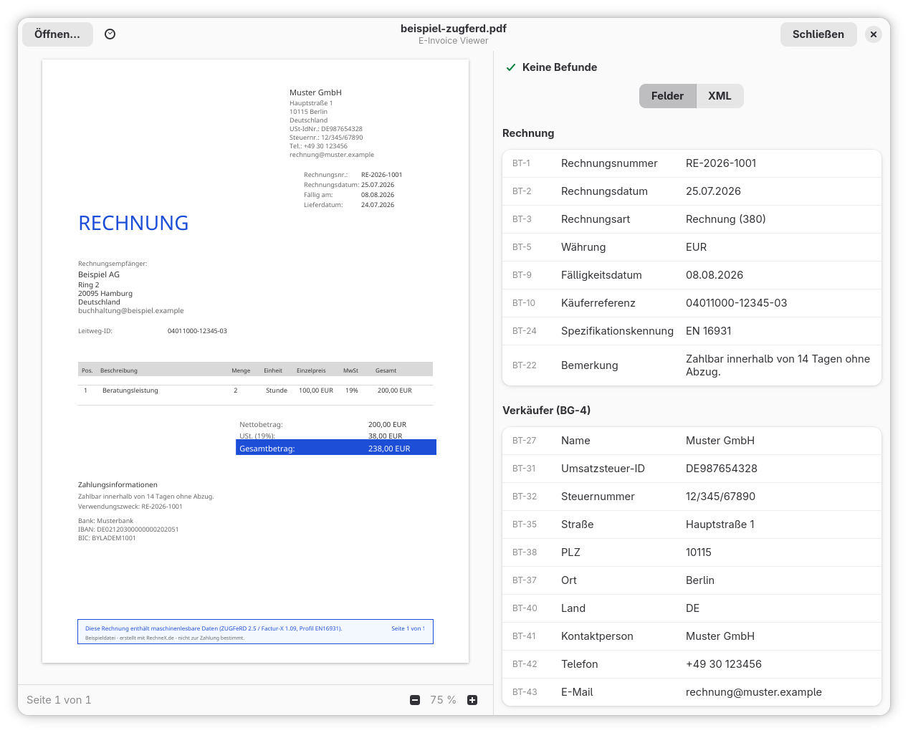

# E-Invoice Viewer

**A fast, strictly local desktop viewer for electronic invoices — ZUGFeRD,
Factur-X and XRechnung — for Linux and GNOME.**

Open an invoice and see the PDF and the structured invoice data side by side,
with every field labelled by its EN 16931 business term. Validation findings
appear right next to the field they concern. Nothing leaves your machine.



<p align="center">
  
  
  
  
</p>

## Why

E-invoices are XML. The PDF is what people read, the XML is what counts, and
the two do not always agree. E-Invoice Viewer shows both at once, tells you
what the official rules say about the XML, and does so without Java, without
an online service and without uploading your business data anywhere.

## Features

- **PDF and fields side by side.** All pages of the PDF, zoomable, next to the
  invoice data grouped into sections: invoice, seller, buyer, line items,
  payment, VAT breakdown, totals. Every value carries its business term
  number (`BT-1`, `BG-4`, …) and is formatted for humans (dates, amounts,
  IBANs, code lists).
- **Validation built in.** Checks against the official EN 16931 business rules
  and the XRechnung CIUS (`BR-DE-*`). Findings are shown at the affected field
  or section, with a summary of all errors, warnings and notes.
- **Raw XML view.** The invoice XML, readably formatted, with search. Fields
  and XML are linked both ways: *Show in XML* jumps from a field or finding to
  its element, and the line below the XML tells you which field the cursor is
  in.
- **Attachments.** Lists files embedded in the PDF and supporting documents in
  the invoice (BG-24), and saves them where you choose.
- **Plain XML invoices, too.** CII and UBL (invoice and credit note) files open
  without a PDF.
- **Desktop integration.** Drag and drop, *Open with* from the file manager,
  a recent files list, one invoice per window. The window size is remembered,
  but never restored in a way that hides the window.

## Strictly local, read-only

Invoices contain personal and business data. E-Invoice Viewer therefore:

- **never opens a network connection** and never loads external content —
  links in an invoice are shown as text, never fetched;
- **never writes to or next to the opened file** — files are only written
  through an explicit *Save as…*;
- **runs the validation inside the app** — no Java runtime, no external
  validator, no web service.

## Supported formats

| Input | Details |
|---|---|
| ZUGFeRD / Factur-X PDF | Embedded `factur-x.xml`, `zugferd-invoice.xml` or `xrechnung.xml` |
| XRechnung | CII and UBL |
| UN/CEFACT CII | `CrossIndustryInvoice` |
| OASIS UBL 2.1 | `Invoice` and `CreditNote` |

Profiles EN 16931 (Comfort), XRechnung, Basic and Extended are shown in full.
Minimum and Basic WL are shown with a note that they are not complete
invoices; the EN 16931 rules are not applied to them.

## Validation

The app evaluates the **official, unmodified Schematron rules** with a
pure-Rust XPath 3.1 engine ([xee](https://github.com/Paligo/xee)):

| Rule set | Version |
|---|---|
| CEN EN 16931 validation artefacts (CII and UBL) | 1.3.17 |
| KoSIT XRechnung Schematron | 2.6.0 (XRechnung 3.0.2) |

The results are tested against the reference output of the official KoSIT
validator for its public test invoices. How and why this works is described in
[ADR 0002](docs/adr/0002-validation-engine.md).

> [!NOTE]
> The validation is meant to help you read and check invoices. It is not a
> certified validation, and this project is not affiliated with KoSIT or CEN.

## Installation

E-Invoice Viewer is built from source for now.

### 1. Install the build dependencies

You need Rust 1.92 or newer ([rustup](https://rustup.rs)) and the development
files of GTK 4.12+, libadwaita 1.5+, Poppler (GLib) and GtkSourceView 5.

```bash
# Arch Linux
sudo pacman -S --needed base-devel gtk4 libadwaita poppler-glib gtksourceview5
```

```bash
# Debian / Ubuntu (24.04 or newer)
sudo apt install build-essential libgtk-4-dev libadwaita-1-dev libpoppler-glib-dev libgtksourceview-5-dev
```

```bash
# Fedora
sudo dnf install gcc gtk4-devel libadwaita-devel poppler-glib-devel gtksourceview5-devel
```

### 2. Build and install

Clone this repository, then install for the current user (no root needed):

```bash
scripts/install.sh
```

This builds a release binary, copies it to `~/.local/bin/e-invoice-viewer` and
adds a desktop entry, so that the app shows up in the app grid and under
*Open with* for PDF and XML files. It never makes itself the default
application. To remove it again:

```bash
scripts/install.sh --uninstall
```

To just try it without installing:

```bash
cargo run --release -p e-invoice-viewer -- path/to/invoice.pdf
```

## Usage

Open an invoice with **Öffnen…**, by dropping it onto the window, from the
file manager, or on the command line:

```bash
e-invoice-viewer invoice.pdf
```

| Shortcut | Action |
|---|---|
| <kbd>Ctrl</kbd>+<kbd>O</kbd> | Open an invoice |
| <kbd>Ctrl</kbd>+<kbd>W</kbd> | Close the invoice, or the window |
| <kbd>Ctrl</kbd>+<kbd>Q</kbd> | Quit |
| <kbd>Ctrl</kbd>+<kbd>F</kbd> | Search in the XML |
| <kbd>Ctrl</kbd>+<kbd>+</kbd> / <kbd>Ctrl</kbd>+<kbd>-</kbd> | Zoom the PDF in / out |
| <kbd>Ctrl</kbd>+<kbd>0</kbd> | Fit the PDF to the pane width |

The user interface is in German, the language of most of its users.

## Limitations

- Linux with GTK4 only; there are no packages yet (an AUR package is
  planned).
- Display only: invoices cannot be created or edited.
- PDF/A conformance and ZUGFeRD-specific profile rules are not checked.

## How it is built

The workspace has two crates with a strict boundary:

- [`crates/core`](crates/core) — all domain logic, no GUI dependencies:
  reading PDFs and XML, detecting syntax and profile, mapping to the field
  model, validation, attachments.
- [`crates/app`](crates/app) — the GTK4 / libadwaita user interface, presentation
  only.

The project is developed spec by spec: every feature starts as a reviewed
specification in [`specs/`](specs/) with acceptance criteria, which are traced
to automated tests or documented manual checks. Requirements are summarised in
[docs/requirements.md](docs/requirements.md), architecture decisions live in
[docs/adr/](docs/adr/). The method itself is the vendored
[ai-harness](ai-harness/README.md).

## Development

```bash
cargo test --workspace
cargo clippy --workspace --all-targets -- -D warnings
cargo fmt --all --check
```

Test invoices are synthetic or taken from public sample sets
([docs/fixtures.md](docs/fixtures.md)); real invoices are never committed.

## Licence

E-Invoice Viewer is free software under the
[GNU General Public License v3.0 or later](LICENSE),
because it uses Poppler ([ADR 0001](docs/adr/0001-gtk4-poppler-gpl.md)).

Bundled third-party material keeps its licence:

- CEN EN 16931 validation artefacts — European Union Public Licence 1.2
  ([`crates/core/rules/cen-1.3.17`](crates/core/rules/cen-1.3.17))
- KoSIT XRechnung Schematron and validator configuration — Apache License 2.0
  ([`crates/core/rules`](crates/core/rules))
- KoSIT test invoices — Apache License 2.0
  ([`crates/core/tests/fixtures/kosit`](crates/core/tests/fixtures/kosit))
